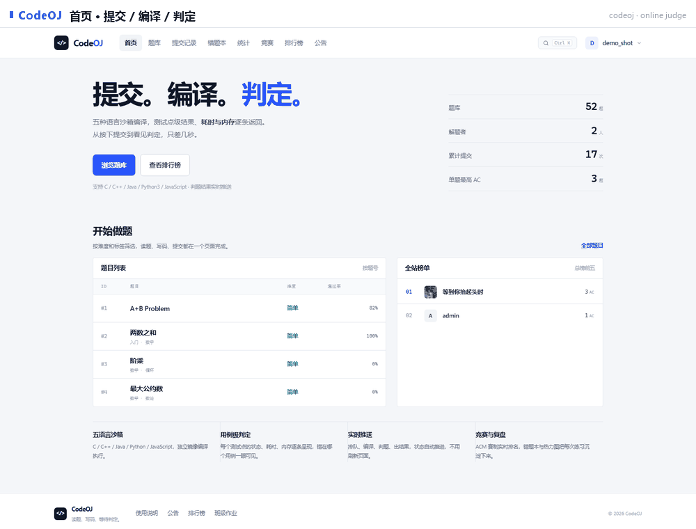

# CodeOJ 截图与演示素材

线上地址：<http://47.107.242.10>

所有素材均由真实生产环境（Docker + MySQL + Redis + RabbitMQ 全量容器）实测截取，
演示账号 `demo_shot` 提交的 C++ 代码经真实沙箱评测通过（提交 #19，2/2 测试点 AC，
耗时 10 ms / 内存 3.5 MB）。

## 演示动图

`demo.gif` —— 6 个页面循环播放（首页 → 题库 → 题目详情 → 判题结果 → 学习统计 → 排行榜）。

## 桌面端

| 页面 | 文件 | 说明 |
|---|---|---|
| 首页 | `01-home.png` | 提交 / 编译 / 判定主视觉，站内统计与全站榜单 |
| 题库 | `02-problems.png` | 52 道题，按难度、标签、关键词检索，通过率可视化 |
| 题目详情 | `03-problem-detail.png` | 题面与 Monaco 编辑器左右分屏，多语言切换 |
| 竞赛 | `04-contests.png` | ACM 赛制竞赛列表 |
| 排行榜 | `05-leaderboard.png` | 按 AC 数排序，含通过率与最后活跃 |
| 提交记录 | `12-submissions.png` | 历史提交列表 |
| 判题结果 | `11-submission-result.png` | 逐测试点耗时、内存、状态，提交代码回显 |
| 学习统计 | `13-statistics.png` | 难度覆盖、判题状态分布、七日趋势、能力雷达 |
| 错题本 | `14-wrongbook.png` | 错题沉淀与复习 |
| 登录 | `07-login.png` | 登录页 |
| 帮助与关于 | `08-about.png` | 使用说明与技术架构 |

## 移动端自适应

| 页面 | 文件 |
|---|---|
| 首页 | `09-home-mobile.png` |
| 题库 | `10-problems-mobile.png` |

## 判题链路证据

| 项 | 值 |
|---|---|
| 提交 ID | #19 |
| 语言 | C++ |
| 结果 | 通过（2/2 测试点） |
| 耗时 | 10 ms |
| 内存 | 3.5 MB |
| 判题时刻 | 2026-11-25 15:16:37 |

截图由 Chrome headless + CDP 从 `http://47.107.242.10` 实际渲染抓取，
非设计稿、非本地模拟。
